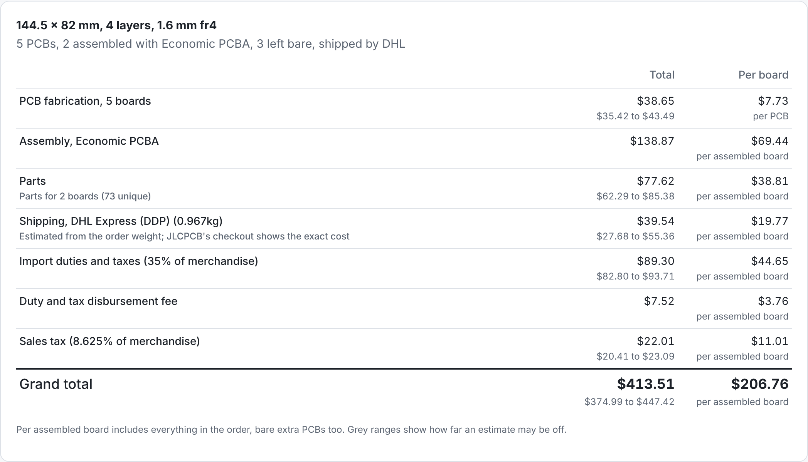

# circuit-json-to-jlcpcb-quote

Convert [Circuit JSON](https://github.com/tscircuit/circuit-json) into a JLCPCB
manufacturing quote.

The estimate covers bare PCBs, the charges JLCPCB engineers add after review
(such as the 4-wire Kelvin test for small vias), assembly fees and parts.
Shipping, duties and taxes are not included.

## Installation

Releases are published to GitHub Packages and served from jscdn, so no registry
configuration or token is needed:

```sh
bun add https://jscdn.tscircuit.com/@tscircuit/circuit-json-to-jlcpcb-quote/0.0.2.tgz
```

## Usage

```ts
import {
  convertCircuitJsonToJlcpcbQuote,
  formatJlcpcbQuote,
} from "@tscircuit/circuit-json-to-jlcpcb-quote"

const quote = await convertCircuitJsonToJlcpcbQuote({
  circuitJson,
  quantity: 5,
  assembledQuantity: 2,
  assembly: "auto", // "economic" | "standard" | "none"
  surfaceFinish: "hasl_leaded", // "hasl_lead_free" | "enig"
})

console.log(formatJlcpcbQuote(quote))
```

`quote.summary` lists every expense on one table, each with its total and
per-board price, and ends with a grand total that includes shipping and
taxes. Fabrication is per PCB; everything else is per assembled board (or per
PCB without assembly). The text output and the quote page show it first.

Assembled boards may be fewer than PCBs (the rest stay bare), never more.

The quote keeps three things apart:

- **Board fabrication** at the standard price: `fabricationTotal` and
  `fabricationPerBoard`.
- **Additional fees** the design triggers, such as the 4-wire Kelvin test for
  very small vias: `additionalFees`, each with a `reason` and `howToAvoid`,
  and `additionalFeesTotal`. They are not part of the fabrication or assembly
  price.
- **Assembly**, priced for both services in `assemblyOptions` (Economic and
  Standard PCBA, each with `total` and `perBoard`). A service JLCPCB does not
  offer for the board carries an `unavailableReason` instead.

`total` is JLCPCB's "Merchandise Total": fabrication + additional fees + the
service in `order.assembly`.

## Shipping and taxes

`shippingOptions` adds what JLCPCB's checkout charges on top for delivery to
the US with duties paid, for DHL and UPS side by side, and `grandTotal` uses
`carrier` (DHL by default):

- **Shipping:** pass the exact `shippingCost` from the checkout, or it is
  estimated from the order weight (`shippingWeightKg`, as JLCPCB's quote page
  shows it, or estimated from the board). The estimate is fitted to very few
  orders and carries a wide range.
- **Import duties and taxes:** 35% of the merchandise total.
- **Duty and tax disbursement fee:** the carrier's fixed fee.
- **Sales tax:** `salesTaxRate` of the merchandise total. Shipping is not
  taxed. The rate depends on the delivery address; the default is the rate on
  tscircuit's own orders.

The import and sales tax rules reproduce three real checkouts to within two
cents.

From the command line:

```sh
bun scripts/quote.ts board.circuit.json --qty 5 --assembled 2 --assembly economic
```

An existing fabrication export can be quoted directly with
`quoteFabricationFiles`, or:

```sh
bun scripts/quote-fabrication-files.ts unzipped-export/ --qty 5 --assembled 5
```

## Quote page



`site/` is a drag-and-drop page: drop a fabrication zip, loose Gerber and
drill files with `bom.csv` and `pick_and_place.csv`, or a Circuit JSON file,
and it shows the summary table first, with the details folded below. It runs entirely in the browser (jlcsearch allows
cross-origin requests), so it is a static site:

```sh
bun run build:site   # writes site/dist
```

`vercel.json` builds and serves it on Vercel.

## How it works

Circuit JSON is quoted the way JLCPCB quotes an order: from fabrication files.

1. `convertCircuitJsonToFabricationFiles` generates Gerbers, drill files,
   `bom.csv` and `pick_and_place.csv` with the same converters and options as
   the tscircuit.com fabrication export and `tsci export -f gerbers`.
2. `getQuoteInputsFromFabricationFiles` reads size, layers, vias, holes,
   trace widths, paste openings and the BOM back out of those files.
3. `lookupJlcParts` prices each BOM line from
   [jlcsearch](https://jlcsearch.tscircuit.com): unit price, stock, whether
   the part is basic or preferred, and its footprint's pads. Resistors and
   capacitors with no part number are matched by rating and package.
4. `estimateJlcpcbQuote` applies the prices and rules in
   `lib/jlcpcb-price-table.ts`. It is pure, so real orders are replayed
   against it in the tests.

Board thickness and material are order-form choices the files do not carry;
they are read from the `pcb_board` element.

## It refuses instead of guessing

A quote that silently leaves something out comes out low, so these throw:

- a BOM line that cannot be priced (no part number, not on jlcsearch, no
  footprint). Pass `unresolvedParts: "exclude"` to quote without those
  lines; they are then listed in `quote.excludedBomLines`.
- a part lookup that fails or answers in an unexpected shape
- a board with no price in the table: a layer count, rigid thickness,
  material or surface finish that has not been priced

## Part prices

All part details come from jlcsearch. It reports a single-piece price, so
the parts line is an estimate with a range: JLCPCB's quantity price breaks are
not applied, and the spares JLCPCB bills for extended parts are estimated from
the unit price. On the one live quote checked, this puts the parts line about
10% high ($180.87 against $164.76) and the whole quote about 4% high.

The estimator already applies price breaks and billed spares when a part
carries them (`JlcPart.priceTiers`, `JlcPart.billing`); with those the same
quote's parts line matches JLCPCB to the cent. They only need to be exposed by
jlcsearch.

## Confidence

Each line item carries a confidence:

- `published`: taken from JLCPCB's help pages.
- `quoted`: read off a live JLCPCB quote page.
- `calibrated`: fitted to tscircuit's own shipped orders.
- `heuristic`: an approximation with a wide low/high range. Bare-PCB prices
  for 1-2 layer boards over 100x100mm, more than 5 pieces, 6+ layers, ENIG
  and all flex boards are heuristic today.

## Development

```sh
bun install
bun test
bun run typecheck
bun run format
```

The package ships its TypeScript source from `lib/` and has no build step.
Every push to `main` after the first publishes a new version, so replace
`0.0.2` above with the version in `package.json`.
